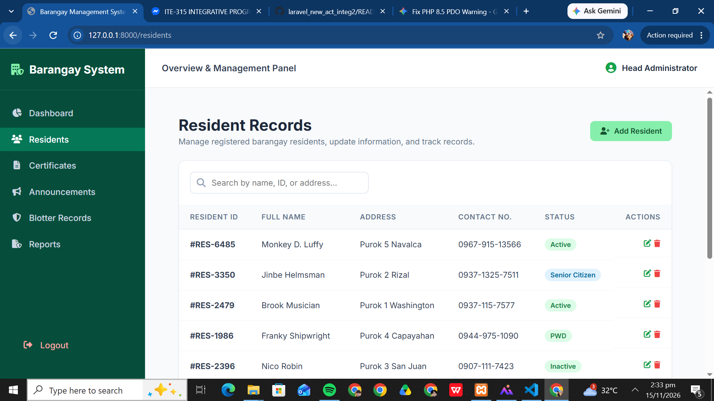
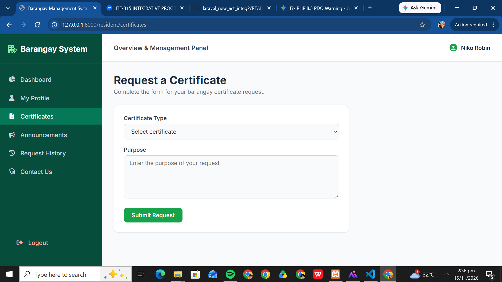
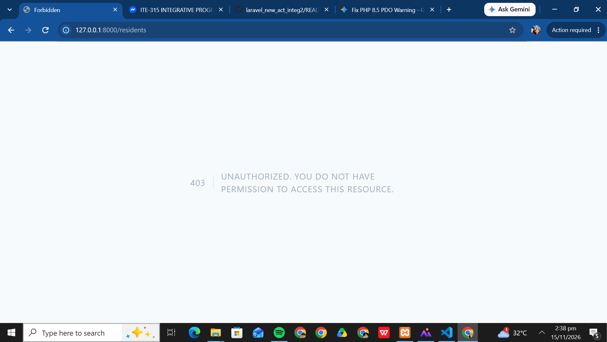
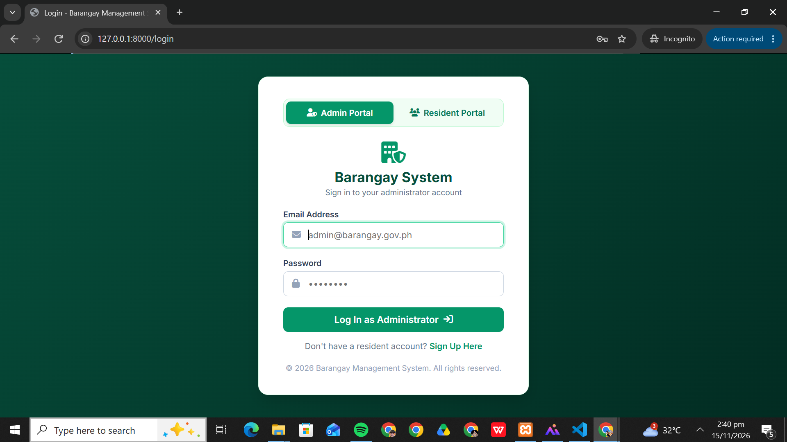
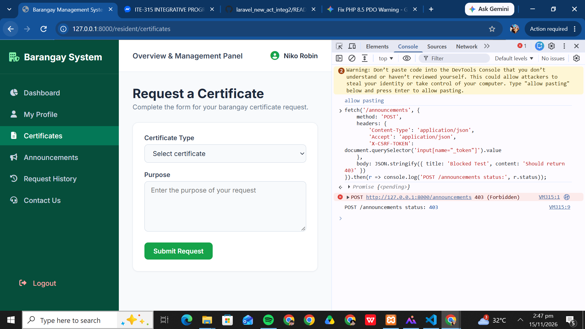

## Laboratory Activity 2 — RBAC

### Project Overview
- **Project Title:** Barangay Management System (`BarangaySystem`)
- **Description:** A Laravel 9 web-based barangay administration and resident self-service portal that streamlines resident records, certificate issuance, blotter case logging, community announcements, and reporting with Role-Based Access Control (RBAC).

### Selected Approach
- **Dynamic Middleware (`Option A`):** A single parameterized middleware (`CheckRole`) accepts one or more allowed roles as route parameters (e.g., `role:admin`, `role:resident`, or `role:admin,resident`) instead of creating separate hard-coded middleware classes per role.

### Role-and-Permission Matrix

| Feature / Action | Guest (Unauthenticated) | `resident` | `admin` |
| :--- | :---: | :---: | :---: |
| Login & Register (`GET/POST /login`, `/register`) | Allowed | Redirects to Portal | Redirects to Portal |
| Logout (`POST /logout`) | Blocked (`302` $\rightarrow$ `/login`) | Allowed | Allowed |
| View Shared Barangay Announcements (`GET /barangay-announcements`) | Blocked (`302` $\rightarrow$ `/login`) | Allowed | Allowed |
| Resident Dashboard, Profile & Contact (`GET/POST /resident/dashboard`, `/profile`, `/contact`) | Blocked (`302` $\rightarrow$ `/login`) | Allowed | Denied (`403`) |
| Request Certificate & View Request History (`GET/POST /resident/certificates`, `/request-history`) | Blocked (`302` $\rightarrow$ `/login`) | Allowed | Denied (`403`) |
| Admin Dashboard & Reports (`GET /dashboard`, `/reports`) | Blocked (`302` $\rightarrow$ `/login`) | Denied (`403`) | Allowed |
| Manage Residents (`GET/POST/PUT/DELETE /residents`) | Blocked (`302` $\rightarrow$ `/login`) | Denied (`403`) | Allowed |
| Manage & Issue Certificates (`GET/POST/PUT/DELETE /certificates`) | Blocked (`302` $\rightarrow$ `/login`) | Denied (`403`) | Allowed |
| Manage Announcements (`GET/POST/PUT/DELETE /announcements`) | Blocked (`302` $\rightarrow$ `/login`) | Denied (`403`) | Allowed |
| Manage Blotter Records (`GET/POST/PUT/DELETE /blotter`) | Blocked (`302` $\rightarrow$ `/login`) | Denied (`403`) | Allowed |

### Middleware Configuration & Protected Routes
- **Middleware Class:** `App\Http\Middleware\CheckRole` (`app/Http/Middleware/CheckRole.php`)
- **Registered Alias:** `'role'` registered inside `$routeMiddleware` in `app/Http/Kernel.php` *(Laravel 9 equivalent of Laravel 11–13 `bootstrap/app.php` `withMiddleware`)*.
- **Protected Routes & Actions (`routes/web.php`):**
  - **Admin-Only Group (`['auth', 'role:admin']`):** Protects `GET /dashboard`, `GET /reports`, and all `GET`, `POST`, `PUT`, and `DELETE` actions for `/residents`, `/certificates`, `/announcements`, and `/blotter`.
  - **Resident-Only Group (`['auth', 'role:resident']`):** Protects `GET /resident/dashboard`, `GET/POST /resident/profile`, `GET/POST /resident/certificates`, `GET /resident/announcements`, `GET /resident/request-history`, and `GET/POST /resident/contact`.
  - **Shared Authenticated Group (`['auth', 'role:admin,resident']`):** Protects `GET /barangay-announcements`, allowing both roles to access the shared announcements feed while blocking unau
  thenticated guests.

### How the Middleware Authorizes Requests
When an incoming HTTP request hits a protected route, Laravel's `auth` middleware first verifies whether the user has an active authenticated session, redirecting unauthenticated guests to `/login`. Next, the `CheckRole` middleware inspects `$request->user()` and checks if the authenticated user's `role` column in the `users` table matches any of the variadic `$roles` passed to the route (such as `admin`, `resident`, or `admin,resident`). If the user's role is included in the allowed list, `$next($request)` passes the request through to the controller. Otherwise, `abort(403, 'Unauthorized. You do not have permission to access this resource.')` immediately halts execution before any controller logic or database mutation can occur.

### Verification Evidence
1. **Admin Allowed (`role:admin`):** 
2. **Resident Allowed (`role:resident`):** 
3. **Role Denied on Direct Admin URL (`403 Forbidden`):** 
4. **Guest Blocked / Redirected to Login (`302` $\rightarrow$ `/login`):** 
5. **Restricted Create/Update/Delete Action Denied (`POST /announcements` $\rightarrow$ `403`):** 

### Reflection
One of the main challenges during implementation was ensuring that middleware protection covered not only visible `GET` pages, but also every underlying `POST`, `PUT`, and `DELETE` form endpoint, as well as handling framework version differences between Laravel 9 (`app/Http/Kernel.php`) and newer Laravel releases. Testing cross-role access also required careful session management using Incognito windows and DevTools requests to verify that forged write actions are blocked cleanly without modifying database records. Server-side authorization is essential because hiding navigation links or buttons in Blade templates only alters the user interface; any user can still manually type a restricted URL or submit a crafted `POST`/`DELETE` request directly to the server unless the backend enforces role checks on every route.